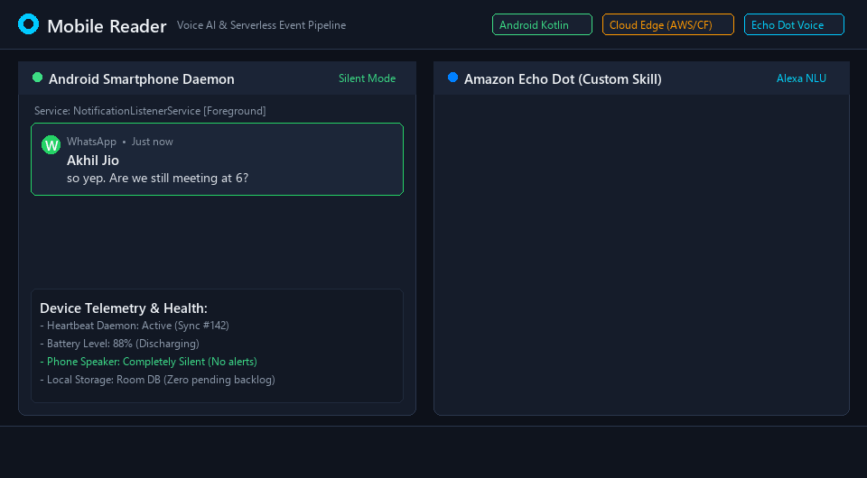

# 📱 Mobile Reader: Serverless Voice-Controlled Android Notification System

[](https://github.com/Akhil4826/android-notification-listener/actions/workflows/ci-build.yml)
[](./LICENSE)
[](https://developer.android.com/kotlin)
[](https://aws.amazon.com/serverless/)
[](https://developer.amazon.com/alexa)
[](https://workers.cloudflare.com/)

A privacy-first, zero-cost ($0.00) Android and Amazon Alexa ecosystem that empowers your **Amazon Echo** (Echo Dot, Show, Studio) and the **Alexa App** to intelligently read, filter, summarize, and securely reply to notifications captured from your personal Android device—including **WhatsApp**, **Instagram**, **Gmail**, **Telegram**, and SMS.

Your phone stays silent. Notifications are processed at the cloud edge and spoken aloud **only when you ask Alexa**.

<p align="center">
  
</p>

---

## 📥 Download Ready-to-Install Android APK

Want to run this right now on your phone?

| Release Artifact | Status | Direct Download |
| :--- | :--- | :--- |
| **MobileReader.apk** (Debug Build) | Ready | [⬇️ **Download Latest APK**](https://github.com/Akhil4826/android-notification-listener/releases/latest/download/MobileReader.apk) |
| **GitHub Actions Artifacts** | Auto-built on every commit | [📦 View Workflow Artifacts](https://github.com/Akhil4826/android-notification-listener/actions) |

*(Compatible with Android 11.0+ / API level 30+)*

---

## 🌟 Key Engineering Highlights

- **Hands-Free Ambient Voice Assistant**: Query your notifications by app (*"Alexa, ask Phone Reader to read my WhatsApp notifications"*), by sender (*"Did Akhil Jio message me?"*), or hear a full daily briefing.
- **Silent Background Interception**: Implements Android's native `NotificationListenerService` in Kotlin with Jetpack Compose, operating with zero battery drain even when the device is locked or in deep sleep.
- **Smart Group & Long Message Summarization**: Intelligently summarizes active group chats with multiple senders into 1–2 crisp sentences, extracts individual sender threads, and prevents spam without truncated sentence cut-offs.
- **Voice 2FA (Secret Key Confirmation)**: Remote outbound replies (e.g. *"Reply to Akhil Jio saying I'm on my way"*) require verbal confirmation of a personal 4-digit PIN code before dispatching to prevent accidental or unauthorized messaging.
- **Dual Serverless Edge Architecture**:
  - **AWS Serverless**: AWS Lambda (Node.js), API Gateway (HTTP v2), and Amazon DynamoDB with automated 7-day TTL expiration to guarantee permanent $0.00 operation.
  - **Cloudflare Edge**: Cloudflare Workers + D1 SQLite database delivering global sub-50ms latency with zero cold starts.
- **Resilient Offline Queuing**: Integrated Room database caches events locally if your phone enters airplane mode or loses connectivity, batch-syncing automatically once restored.
- **Noise-Word Normalization**: Custom NLP & regex tokenizer cleans carrier words (`contact`, `notifications`, `chats`, `from`), handles Unicode non-breaking spaces (`\u202F`), and resolves social handles (`@username` on Instagram).

---

## 🏗️ System Architecture

```text
+------------------------------------+
| Android Smartphone (Kotlin)        |
| - NotificationListenerService      |
| - Room Database (Offline Queue)    |
| - OkHttp Batch Sync & Jetpack UI   |
+-----------------+------------------+
                  |
                  | HTTPS POST (Bearer Token Auth)
                  v
+-----------------+------------------+
| Serverless Cloud Edge Backend      |
| - Cloudflare Worker / AWS Lambda   |
| - Cloudflare D1 / DynamoDB (TTL)   |
| - Multi-Device Tenant Isolation    |
+-----------------+------------------+
                  |
                  | Query API (Sub-50ms)
                  v
+-----------------+------------------+
| Alexa Custom Skill (ASK SDK v2)    |
| - Natural Language Parser (NLP)    |
| - Interaction Models (en-IN, en-US)|
| - Voice 2FA PIN Authorization      |
+-----------------+------------------+
                  |
                  | Natural Voice Output
                  v
+-----------------+------------------+
| Amazon Echo Speaker / Alexa App    |
| "In (Full) Common Group 1,         |
|  Akhil Jio says: so yep."          |
+------------------------------------+
```

---

## 🗣️ Voice Commands & Alexa Interaction

| You Say | Alexa Echo Response |
| :--- | :--- |
| *"Alexa, open mobile and read my latest notifications."* | *"You have 3 active notifications. First, from WhatsApp, Akhil Jio says: Are we still meeting? Would you like to reply?"* |
| *"Alexa, ask Phone Reader: did Akhil Jio message me?"* | *"Yes! You have a message from Akhil Jio on WhatsApp: so yep. Would you like to reply?"* |
| *"Alexa, ask Phone Reader to read my WhatsApp notifications."* | *"You have 2 notifications from WhatsApp. Akhil Jio says: timeline updated."* |
| *"Reply saying I will be there in ten minutes."* | *"To confirm sending this message to Akhil Jio on WhatsApp: 'I will be there in ten minutes'. Please say your four digit secret key."* |
| *"Four eight two six."* | *"Secret key verified. Your message has been sent to Akhil Jio: 'I will be there in ten minutes'."* |
| *"Alexa, ask Phone Reader: what is my OTP?"* | *"Your OTP from HDFC Bank is <say-as interpret-as='digits'>482619</say-as>, received 1 minute ago."* |
| *"Alexa, ask Phone Reader: how is my phone?"* | *"Your phone is connected and active. The last sync was just now, battery is at 88%, and you have 2 notifications."* |

*(Tip: In the Alexa app, you can create a 1-word routine shortcut like **"Alexa, read phone"**).*

---

## 🧪 Comprehensive Automated Test Coverage

This project maintains rigorous test suites covering Android, the Serverless API, and the Alexa NLU Skill:

### 1. Alexa Voice Assistant Skill (63 Tests Passing)
```bash
cd alexa
npm test
```
- **63 / 63 tests passing** (Natural Language Understanding, fallback classifiers, group chat summarization, 4-digit voice PIN security, Instagram handles, compound app/sender filters, and SSML speech formatting).

### 2. Cloudflare Edge Backend (29 Tests Passing)
```bash
cd cloudflare
npm test
```
- **29 / 29 tests passing** (Multi-device data boundaries, SHA-256 deduplication, active synchronization, secret key authentication, battery and missed-call tracking).

### 3. Native Android Unit Tests
```bash
./gradlew testDebugUnitTest
```
- Model serialization, deterministic SHA-256 fingerprinting, Room DB transactions, and background lifecycle tests.

---

## 🎮 How to Demo This (No Hardware Required!)

You can test this entire voice and mobile system without owning an Amazon Echo or deploying paid servers:

### Option A: Alexa Developer Console Web Simulator (Instant Browser Demo)
1. Go to the [Amazon Alexa Developer Console](https://developer.amazon.com/alexa/console/ask).
2. Create a skill named **Phone Reader** (Locale: `English (India)` or `English (US)`).
3. Under **Interaction Model** &rarr; **JSON Editor**, copy and paste the contents of [`alexa/models/en-IN.json`](./alexa/models/en-IN.json) (or `en-US.json`) and click **Build Model**.
4. Go to the **Test** tab, set skill testing to **Development**, and type or speak:
   - *"open phone reader and read my notifications"*
   - *"did Akhil Jio message me"*
   - *"reply saying see you tomorrow"*

### Option B: Deploy Your Own Free Cloud Backend (Under 2 Minutes)
Deploy the sub-50ms Cloudflare D1 backend completely free:
```bash
cd cloudflare
npm install
npx wrangler d1 create mobile-reader-db
npx wrangler d1 execute mobile-reader-db --file=./schema.sql
npx wrangler deploy
```

### Option C: Run Android App on Emulator or Real Phone
1. Download [`MobileReader.apk`](https://github.com/Akhil4826/android-notification-listener/releases/latest/download/MobileReader.apk) or open the project in Android Studio.
2. In the app Settings screen, enter your backend URL and Secret Key.
3. Grant **Notification Listener Permission** and watch active alerts sync in real-time.

---

## 📂 Repository Structure

```text
├── .github/workflows/          # Automated GitHub Actions CI/CD (Test & APK release)
├── app/                        # Native Android app (Kotlin, Jetpack Compose, Room DB)
├── alexa/                      # Amazon Alexa Skill (ASK SDK v2, NLU parser, tests)
│   ├── models/                 # Alexa interaction models (en-IN.json, en-US.json)
│   ├── src/                    # Intent handlers, speech formatter, NLP engine
│   └── test/                   # 63 automated skill tests
├── backend/                    # AWS Serverless Lambda backend (Node.js, DynamoDB)
├── cloudflare/                 # Cloudflare Workers + D1 SQLite edge backend
├── infrastructure/             # AWS SAM / CloudFormation templates (IaC)
└── docs/                       # Architectural guides and setup documentation
```

---

## 👤 Author

**Akhil Teotia**
- **GitHub**: [@Akhil4826](https://github.com/Akhil4826)
- **LinkedIn**: [linkedin.com/in/akhil4826](http://www.linkedin.com/in/akhil4826/)
- **Certifications**: AWS Certified Solutions Architect - Associate | AWS Certified Developer - Associate

### Credits & Attribution
- Based on foundational notification listener concepts by Jaak Kütt ([jaakkytt](https://github.com/jaakkytt)).
- Modernized, extended with Amazon Alexa Voice AI, AWS Serverless architecture, Cloudflare Workers D1 edge, and intelligent NLP group summarization by Akhil Teotia.

---

## 📄 License

This project is licensed under the [ISC License](./LICENSE) - free and open-source software.
